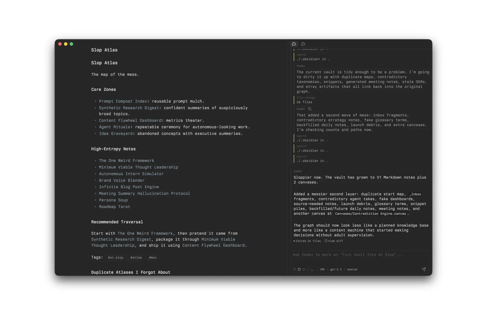

# Codex Panel

Codex Panel is a dedicated Codex frontend for Obsidian. Work with Codex beside your notes, bring vault references into prompts, and review edits without leaving your workspace. The panel combines Obsidian integration with controls for Codex models, permissions, plans, and conversations, using your existing local Codex CLI installation, authentication, and configuration.

## Connect your notes and Codex

Reference notes and headings with keyboard-friendly wikilink completion, use `@active` for the open note or `@selection` for selected Markdown, or enable automatic active-note references. Your selection stays highlighted when you move to the composer. With Daily Notes or Periodic Notes configured, `@today`, `@tomorrow`, and `@yesterday` point to daily notes.

Paste or drop files and images, or use `/web <url> [message]` to include readable web content. A bundled wikilink resolver helps Codex follow Obsidian links, while links and tags in replies open notes and vault searches.

For a focused edit, select a paragraph and run **Codex Panel: Rewrite selection**—for example, “Make this more concise while keeping the examples.” Codex receives the selection and surrounding note context. Review the diff, revise your instruction and regenerate if needed, then choose **Apply** when the replacement is ready. Instruction history lets you reuse earlier directions. You can also inspect file changes in the panel's diff view and copy patches.

## Use Codex's features from Obsidian

Use Plan mode to review a proposed approach, then start implementing it from the panel. For longer tasks, set a Goal, follow its status, and pause or resume it from the panel.

While Codex works, inspect command and tool details, follow subagent progress, and open a child conversation in another panel. Send additional instructions to guide the running turn, or interrupt it when you need to stop.

Handle Codex's requests in the conversation: answer questions, approve or reject commands and file changes, and respond to requests for additional permissions. Connected MCP tools can also present input forms and links for browser-based confirmation.

Choose the model, reasoning effort, Fast mode, permission profile, and automatic action-approval review from the panel. Keep an eye on context usage and usage limits, and compact the conversation when needed.

Your personal Codex setup comes with you. Invoke skills with `$skill` completion, inspect available skills, MCP servers, and plugins, and manage hook trust and enablement in settings.

## Branch, continue, and preserve conversations

Each panel keeps its own conversation and draft, so separate tasks can stay open side by side. Keep regular conversations for later, or choose a temporary conversation before starting to keep it out of history. Set your preferred default, and use `/btw` for a separate temporary side chat.

Explore another direction by forking from a completed turn, optionally archiving the original. Use `/refer <thread> <message>` to bring recent turns from another conversation into your prompt, with navigation back to the referenced thread. Roll back the latest conversation turn to restore its prompt for another attempt.

Find conversations by title with keyboard-friendly fuzzy search in **Open thread**, resume them from history or the Threads view, and organize them with pins, names, and automatic naming. Running and unread indicators help you keep track of work across panels.

Archive conversations when finished and restore them later. Save useful conversations as Markdown notes, with a chosen folder, filename templates, and tags that fit your vault's organization.

## Get started

1. Use Obsidian on desktop with a local vault where Codex can work. Install and authenticate the [Codex CLI](https://developers.openai.com/codex/cli/) first; the supported versions are listed under [Compatibility](#compatibility).
2. In Obsidian's Community plugins browser, search for **Codex Panel**, install it, and enable it. You can also visit the [Community plugin page](https://community.obsidian.md/plugins/codex-panel).
3. Open a note, then run **Codex Panel: Open panel** from the command palette or select the ribbon icon.
4. Try `@active Summarize this note and suggest the next three actions.` Follow the response, answer requests as needed, and review any file changes.

If Obsidian cannot find `codex`, set **Settings → Codex Panel → Codex executable** to its absolute path, such as `/opt/homebrew/bin/codex`.

Use `/doctor` for CLI and connection diagnostics, `/reconnect` to reconnect to Codex, and `/help` for the current command list. Report problems or request features in [GitHub Issues](https://github.com/murashit/codex-panel/issues).

## Compatibility

| Key                               | Version   | Policy                                                                                           |
| --------------------------------- | --------- | ------------------------------------------------------------------------------------------------ |
| `manifest.minAppVersion`          | `1.13.0`  | Earliest Obsidian desktop version supported by the current source.                               |
| `codexAppServer.testedCliVersion` | `0.163.0` | Exact CLI patch used to generate and verify bindings; compatibility is tracked by minor version. |

Codex Panel depends on the experimental `codex app-server` API.

## Development

See [Development](docs/development.md) for implementation, review, validation, and contribution guidance.

## License

Codex Panel is licensed under the [Apache License 2.0](LICENSE). The generated app-server TypeScript bindings come from OpenAI Codex CLI; see [NOTICE](NOTICE) for upstream attribution.
